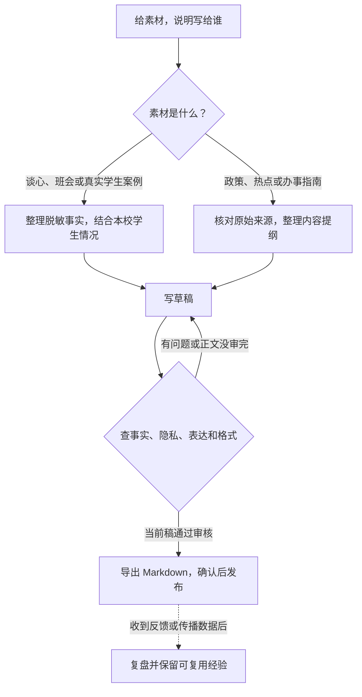

# Counselors-Writing 使用说明（通俗版）

> 这是给「不太懂技术、只想把工作素材写成公众号推文」的辅导员看的说明。
> 版本：Skill 3.3.0（2026年10月30日）。

## 一句话说明

这是一个帮你把「一次谈心谈话、一场班会、一个学生事件」写成公众号爆款推文的工具。你提供素材，它负责：查资料 → 定选题 → 写正文 → 自动做思政检查 → 生成最终稿，并把你用过的好案例、好风格沉淀下来，越用越懂你的学校和学生。

## 它能帮你做什么

- **素材变选题**：把一段工作素材，变成「学生真正关心什么、冲突在哪、能升华成什么」的选题卡。
- **抓热点**：抓微博热搜、tophub 榜单，并自动做「内容风险筛查」，告诉你能不能蹭、有什么坑。
- **写正文**：按你选的文风，写出四段式推文（钩子 → 事件 → 冲突 → 升华）。
- **思政质检（自动门禁）**：写完自动查 8 项（政治方向 / 事实依据 / 价值表达 / 学生隐私 / 标签化语言 / 版权风险 / AI 痕迹 / 格式）+ 标点、去 AI 味。**不通过就不能出稿**。
- **传播复盘沉淀**：把效果好的案例和写法存进案例库、风格库。

## 在 Codex 里开始写

装好 Counselors-Writing 后，在聊天里贴上脱敏素材，或附上文件、公开链接。告诉助手你想写给谁、想让读者看完做什么。可以直接复制这段话，再换成你的素材。

> 请用 counselors-writing，把我附上的班会记录写成一篇给大一新生看的公众号推文。先给我两个选题，分别说明学生关心什么、还缺哪些信息。等我选定后再写。审核通过后，请给我 Markdown 成稿、来源清单和审核结论。



还没想好写什么，可以只要选题卡。已经有稿子，可以先请助手标出事实和隐私问题。有热点时，先请助手筛查、核对来源，再解释它和学生有什么关系。要参考报媒风格，可以给参考链接，请助手提炼标题、开头和结构的写法。

导出后由你核对标题、来源和隐私，再将成稿复制到公众号后台排版。文章有修改就用修改后的稿件重新审核。发布后有阅读、转发或学生反馈，再带着文章和数据回来做复盘。

## 在终端使用

1. 确认电脑有 Python 3.10+，然后装唯一依赖：

   ```bash
   python -m pip install 'pydantic>=2'
   ```

2. 初始化（只需一次）：

   ```bash
   cd counselors-writing
   python scripts/bootstrap.py
   python scripts/kb.py db init
   ```

3. 把素材交给它。新建一个文本文件 `素材.txt`，把谈心/班会/事件的过程写进去，然后：

   ```bash
   python scripts/kb.py ingest --file 素材.txt
   ```

   它会返回一个 `document_id`（形如 `doc-xxxxxxxxxxxx`），记下来，后面用。

> 没有自己的 AI 命令？没关系。下面的命令都可以把 `--llm-cmd "..."` 换成 `--prompt-only`（只让它生成提示词，你自己把提示词丢给 AI，再把结果用 `--result 结果.json` 喂回来）。具体见仓库 `README.md` 的「在不同 Agent 里使用」。

## 两条写作路径

### 路径一：有真实学生案例（谈心 / 班会 / 学生事件）

```bash
# 1) 从素材提取案例
python scripts/kb.py extract <document_id> --extractor case_facts --llm-cmd "<你的AI命令>"

# 2) 案例 × 学校画像 → 映射
python scripts/kb.py mapping --case <case_id> --profile pro-school --llm-cmd "<你的AI命令>"

# 3) 写作
python scripts/kb.py write --mapping <mapping_id> --llm-cmd "<你的AI命令>"
```

### 路径二：写政策解读 / 热点评论 / 指南（没有学生案例）

```bash
# 1) 抓取或粘贴素材（政策文件、热点文章）
python scripts/kb.py ingest --file 政策资料.txt

# 2) 提取选题/内容简报
python scripts/kb.py extract <document_id> --extractor topic_signal --llm-cmd "<你的AI命令>"

# 3) 直接写作（不需要 mapping、不需要捏造案例）
python scripts/kb.py write --topic <topic_id> --mode guide --llm-cmd "<你的AI命令>"
```

## 两条路径都要走的「最后一步」（重点）

写完草稿后，**必须**过门禁再出稿：

```bash
# 标点 + 去 AI 味（确定性，不调 AI，秒过）
python scripts/kb.py punctuation --lang zh 正文.md
python scripts/kb.py deai 正文.md

# 思政 8 项自查（调 AI，返回 AuditRecord）
python scripts/kb.py audit --draft <draft_id> --llm-cmd "<你的AI命令>"

# 出稿 —— 必须带审核 id；审核不存在 / 没过 / 稿子又改过，都会拒绝
python scripts/kb.py output render --draft <draft_id> --audit <audit_id>
```

**为什么这一步是强制的？** 因为之前有人发现：不审核也能直接出稿、审核只看了一半正文却判通过。现在都堵上了——审核通过且稿子没改过，才能出最终稿。实在有特殊情况要强行出稿，用 `--force`，但系统会记一笔「forced=true」留痕。

## 蹭热点时要注意（新增关卡）

热点不是随便蹭的。现在流程是：

```bash
# 1) 抓热点（自动带风险筛查：approved / caution / needs_review / rejected）
python scripts/kb.py hotlist weibo --top 20
# 或更完整的多源版：
python scripts/cw.py hot --sources weibo,tophub --top 20 --save

# 2) 把某个热点的审核状态，绑定到你生成的选题上
python scripts/kb.py hot link --topic <topic_id> --hot <序号|hot-id|标题关键词>

# 3) 写作时，工具会检查：未筛查 / needs_review / rejected 的热点，一律不让写
python scripts/kb.py write --topic <topic_id> --llm-cmd "<你的AI命令>"
```

**记住**：抓取成功 ≠ 审核通过。热点只有 `approved`（或明确标了限制的 `caution`）才能进入写作。

## 三条铁律（千万别踩）

1. **学生隐私是硬门槛**：姓名、学号、班级、宿舍、能定位到某个学生的「独特事件组合」，必须脱敏。工具会自动挡掉学号/手机号/身份证/班级/宿舍，但「姓名」和「独特事件组合」还需要你在素材里就改掉。
2. **事实不能编**：数据、金额、日期、机构、政策表述，必须有来源。来源没有的，就写成「推断/建议」，不能写成确定事实。
3. **通用内容不许捏造成学生案例**：写政策解读就写政策解读，不要为了走流程硬编一个「某同学」出来。

## 常用命令速查

| 想做什么 | 命令 |
|---|---|
| 抓网页 | `kb.py fetch <url>` |
| 粘贴素材 | `kb.py ingest --file 素材.txt` |
| 提取案例/选题/风格 | `kb.py extract <doc> --extractor case_facts\|topic_signal\|style_pattern` |
| 搜索已有案例/风格/选题 | `kb.py search case\|style\|topic <关键词>` |
| 写作 | `kb.py write --mapping <id>` 或 `kb.py write --topic <id>` |
| 审核 | `kb.py audit --draft <id>` |
| 出稿 | `kb.py output render --draft <id> --audit <id>` |
| 抓热点（带筛查） | `kb.py hotlist weibo\|tophub` 或 `cw.py hot` |
| 热点绑定选题 | `kb.py hot link --topic <id> --hot <ref>` |
| 查版本 | `kb.py version` |
| 跑全部测试 | `kb.py test` |

## 常见问题

- **没有 AI 命令怎么办？** 用 `--prompt-only` 拿提示词 → 自己找 AI 生成 JSON → `--result 结果.json` 回灌。三步等价。
- **出稿报「缺少审核记录」？** 说明你还没跑 `kb.py audit`。先审核，再带 `--audit` 出稿。
- **审核过了但出稿还报「内容摘要不一致」？** 说明审核之后你又改了稿。重新 `kb.py audit` 一次。
- **正文太长？** 超过 1 万字左右，审核会明确告诉你「覆盖不完整、不通过」，这是故意设计的保护，不会假装审过。建议拆短或分段处理。
- **热点想用但显示 needs_review？** 先找可核实的来源，补齐信息并重新筛查。只有结果为 `approved`，或为 `caution` 且选题记录了使用限制，才继续写作。

## 查看知识库可视化

想把案例、选题、来源、审核、风格这些数据「看得见」，用独立命令 `/database-check`：

```bash
npm ci --prefix visualization/rhinelab  # 首次安装
python scripts/database_check.py
```

运行后会在本机浏览器打开五类档案。下次要看最新数据，再执行一次 `python scripts/database_check.py`。导出的档案留在本机，原知识库供脚本读取。

## 更多文档

- 完整快速上手：`docs/user/quickstart.md`
- 各命令契约：`scripts/cw.py help`（或 `scripts/core/commands.py`）
- 思政 8 项清单：`references/ideological-review.md`
- 版本变更：`CHANGELOG.md`
